# PRAKTIKUM JARKOM MODUL 3 K 26 - 2026

## Angota Kelompok

| Nama                         | NRP        |
| ---------------------------- | ---------- |
| Az Zahra Fiddien Al Farabi          | 5027251021 |
| Muhammad Faturrahman | 5027241065 |

## Laporan
1. Ketika Curtain menutup Shibuya, jalur komunikasi antar zona Jujutsu High terputus. Pulihkan konektivitas dasar dengan mengonfigurasi jichi: eth0 memperoleh WAN dari NAT, sedangkan eth1–eth4 menjadi gateway Network 1–4 sesuai tabel pemetaan. Aktifkan IPv4 forwarding dan source NAT, lalu tetapkan IP statis host infrastruktur sesuai tabel spesifikasi. Buktikan konektivitas setiap host ke gateway dan akses eksternal dari host yang relevan. 

Pembagian Jaringan

| Network | Subnet | Gateway (jichi) | Interface jichi | Host |
| --- | --- | --- | --- | --- |
| Network 1 | `192.224.1.0/24` | `192.224.1.1` | `eth1` | utahime, shoko, gojo |
| Network 2 | `192.224.2.0/24` | `192.224.2.1` | `eth2` | itadori, fusiguro, zenin, okkotsu |
| Network 3 | `192.224.3.0/24` | `192.224.3.1` | `eth3` | ino, kusakabe, kugisaki, miwa |
| Network 4 | `192.224.4.0/24` | `192.224.4.1` | `eth4` | geto, maki, panda, nanami, todo, kirara, tengen, yaga, inumaki |

Pembagian jaringan untuk host:
| Network | Subnet Prefix | Interface Router (jichi) | Gateway | Nama Host | Tipe / Image | IP Address |
| :--- | :--- | :--- | :--- | :--- | :--- | :--- |
| **Network 1** | 192.224.1.0/24 | eth1 | 192.224.1.1 | utahime | Debian (Infrastruktur) | 192.224.1.2/24 |
| | | | | shoko | Debian (Infrastruktur) | 192.224.1.3/24 |
| | | | | gojo | Debian (Infrastruktur) | 192.224.1.4/24 |
| **Network 4** | 192.224.4.0/24 | eth4 | 192.224.4.1 | geto | Debian (Infrastruktur) | 192.224.4.2/24 |
| | | | | maki | Debian (Infrastruktur) | 192.224.4.3/24 |
| | | | | panda | Debian (Infrastruktur) | 192.224.4.4/24 |
| | | | | nanami | Debian (Infrastruktur) | 192.224.4.5/24 |
| | | | | todo | Debian (Infrastruktur) | 192.224.4.6/24 |
| | | | | kirara | Debian (Infrastruktur) | 192.224.4.7/24 |
| | | | | tengen | Debian (Infrastruktur) | 192.224.4.10/24 |
| | | | | yaga | Debian (Infrastruktur) | 192.224.4.8/24 |
| | | | | inumaki | Debian (Infrastruktur) | 192.224.4.9/24 |

tupologi jaringan
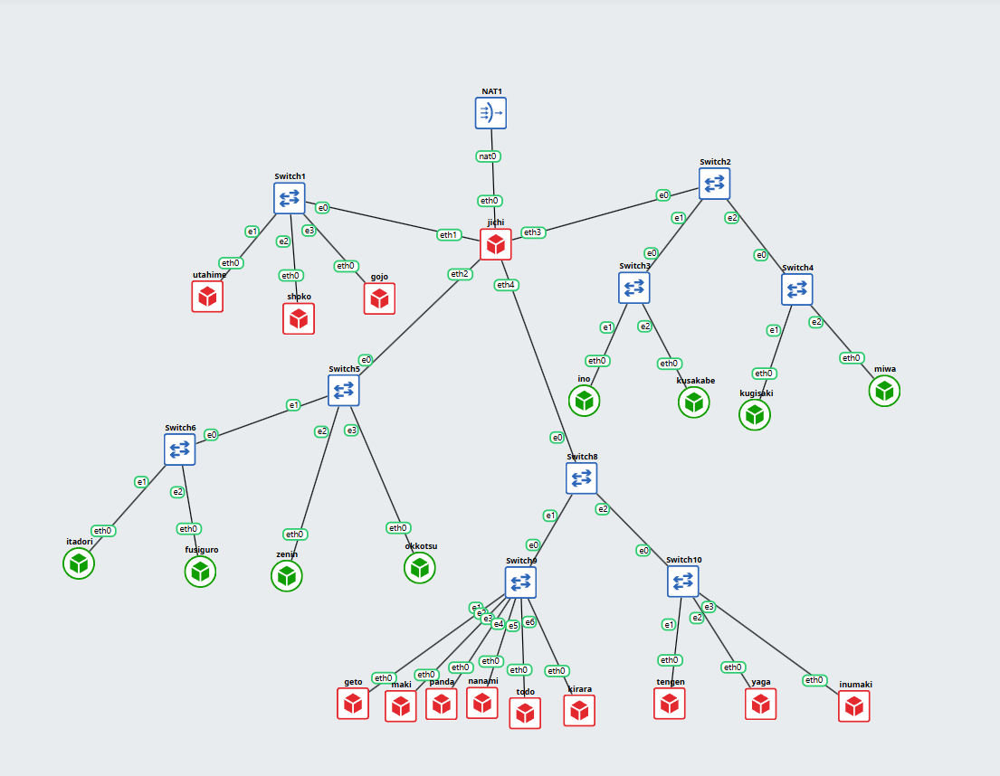 

**Untuk Network 1**

`utahime`:


`shoko`:


**Untuk Network 2**

`geto`:


`tengen`:


2. Tengen, penjaga pusat distribusi di Data Center, harus mengambil alih pengalokasian alamat bagi wilayah yang membutuhkan konfigurasi dinamis. Konfigurasikan isc-dhcp-server pada [PREFIX IP].4.10. Deklarasikan Network 4 ([PREFIX IP].4.0/24) sebagai subnet lokal tanpa pool dinamis, lalu siapkan scope DHCP untuk Network 2 ([PREFIX IP].2.0/24) dan Network 3 ([PREFIX IP].3.0/24). Validasi konfigurasi dan pastikan service aktif tanpa error “No subnet declaration”.

Memperbarui daftar paket dan memasang isc-dhcp-server:
```
apt-get update
apt-get install isc-dhcp-server -y
```

nano /etc/default/isc-dhcp-server:
tambahkan `INTERFACESv4="eth0"`

nano /etc/dhcp/dhcpd.conf:
Deklarasi subnet yang digunakan
```
# Network 4: subnet lokal tanpa pool dinamis
subnet 192.224.4.0 netmask 255.255.255.0 {
}

# Network 2: scope DHCP
subnet 192.224.2.0 netmask 255.255.255.0 {
}

# Network 3: scope DHCP
subnet 192.224.3.0 netmask 255.255.255.0 {
}
```
Menyiapkan direktori dan file database lease DHCP:
```
mkdir -p /var/lib/dhcp
touch /var/lib/dhcp/dhcpd.leases
chmod 644 /var/lib/dhcp/dhcpd.leases
```

Memeriksa sintaks konfigurasi DHCP:
```
dhcpd -t -cf /etc/dhcp/dhcpd.conf
```


Memeriksa deklarasi subnet:
```
grep -nE '^[[:space:]]*subnet ' /etc/dhcp/dhcpd.conf
```


DHCP Server dijalankan secara langsung:
```
dhcpd -4 -cf /etc/dhcp/dhcpd.conf -pf /var/run/dhcpd.pid eth0
```
Memeriksa proses DHCP Server:
```
ps aux | grep '[d]hcpd'
```


3. Permintaan alamat dari Divisi A dan Divisi B tidak dapat menyeberangi subnet secara langsung. Konfigurasikan jichi sebagai DHCP Relay menuju tengen ([PREFIX IP].4.10), menggunakan eth2 untuk Network 2 dan eth3 untuk Network 3. Buktikan bahwa client dari kedua subnet berhasil memperoleh lease melalui relay.

Instal DHCP Relay di jichi:
```
apt-get update
apt-get install isc-dhcp-relay -y
```

Jalankan DHCP Relay:
```
dhcrelay -4 -d -i eth2 -i eth3 192.224.4.10
```

**Untuk Network 2**

Tes koneksi client ke gateway `itadori (Network 2)`:


Uji DHCP Relay `itadori (Network 2)`:


**Untuk Network 3**
Tes koneksi client ke gateway `ino (Network 3)`:


Uji DHCP Relay `ino (Network 3)`:


4. Agar tim Dev dan Support di Divisi A menerima jatah alamat yang berbeda, atur dua pool DHCP pada Network 2. Tetapkan Pool 1 ([PREFIX IP].2.10–[PREFIX IP].2.35) untuk itadori dan fushiguro, serta Pool 2 ([PREFIX IP].2.70–[PREFIX IP].2.95) untuk zenin dan okkotsu. Rentang [PREFIX IP].2.36–[PREFIX IP].2.69 tidak boleh dialokasikan. Karena seluruh client berada pada subnet yang sama, gunakan DHCP class berdasarkan MAC Address atau Client ID untuk memisahkan kedua kelompok.
   
Jalankan perintah berikut pada masing-masing client, yaitu `itadori, fusiguro, zenin, dan okkotsu,` untuk mendapatkan MAC address interface eth0. Catat hasilnya sesuai nama client. 

```
cat /sys/class/net/eth0/address
```
Pada node tengen, buka file konfigurasi DHCP menggunakan perintah:
```
nano /etc/dhcp/dhcpd.conf
```
Tambahkan konfigurasi class berikut untuk mengelompokkan client berdasarkan MAC address:
```
class "pool1" {
    match hardware;
}

class "pool2" {
    match hardware;
}

subclass "pool1" 1:02:42:ba:83:83:00;
subclass "pool1" 1:02:42:03:25:97:00;

subclass "pool2" 1:02:42:e7:5c:5f:00;
subclass "pool2" 1:02:42:79:b8:e1:00;
```
Pool 1 digunakan oleh itadori dan fusiguro, sedangkan Pool 2 digunakan oleh zenin dan okkotsu.

Mengonfigurasi Pool IP Network 2:
Tambahkan konfigurasi subnet Network 2 berikut ke dalam file /etc/dhcp/dhcpd.conf.
```
subnet 192.224.2.0 netmask 255.255.255.0 {
    option routers 192.224.2.1;

    pool {
        range 192.224.2.10 192.224.2.35;
        allow members of "pool1";
    }

    pool {
        range 192.224.2.70 192.224.2.95;
        allow members of "pool2";
    }
}
```
Pool 1 memiliki rentang IP 192.224.2.10–192.224.2.35, sedangkan Pool 2 memiliki rentang IP 192.224.2.70–192.224.2.95. Rentang 192.224.2.36–192.224.2.69 tidak dialokasikan ke pool mana pun.

Pastikan konfigurasi subnet Network 1 tetap tersedia dan pertahankan konfigurasi sementara Network 3 berikut:
```
subnet 192.224.3.0 netmask 255.255.255.0 {
    range 192.224.3.10 192.224.3.89;
    option routers 192.224.3.1;
}
```

Jalankan DHCP server menggunakan konfigurasi yang telah diperbarui.
```
dhcpd -4 -cf /etc/dhcp/dhcpd.conf eth0
```
Periksa apakah proses DHCP server sudah berjalan.
```
ps aux | grep '[d]hcpd'
```

Jalankan di setiap Client Network 2:
```
udhcpc -i eth0
ip -br addr
```

- client 1 `itadori`

  

- client 2 `fusigiro`

  

- client 3 `zenin`

  
  
- client 4 `okkotsu`

  

5. Setiap tim lapangan memiliki durasi operasi yang berbeda. Pada Network 3, berikan short lease 30 menit (1800 detik) kepada ino dan kusakabe, serta long lease 12 jam (43200 detik) kepada miwa. Gunakan pool short lease [PREFIX IP].3.10–[PREFIX IP].3.89 dan pool long lease [PREFIX IP].3.100–[PREFIX IP].3.199. Sesuaikan default-lease-time dan max-lease-time untuk setiap kelas client. Berikan pula DHCP options berupa DNS [PREFIX IP].1.2 dan [PREFIX IP].1.3, serta domain-search <xxxx>.com.
Jalankan perintah berikut pada client ino, kusakabe, dan miwa, catat hasilnya.
```
cat /sys/class/net/eth0/address
```
Tambahkan konfigurasi berikut pada /etc/dhcp/dhcpd.conf untuk membedakan durasi lease setiap kelompok client:
```
class "short" {
    match hardware;
    default-lease-time 1800;
    max-lease-time 1800;
}

class "long" {
    match hardware;
    default-lease-time 43200;
    max-lease-time 43200;
}

subclass "short" 1:02:42:30:35:07:00;
subclass "short" 1:02:42:ac:77:cb:00;
subclass "long" 1:02:42:8a:f5:1e:00;
```
Sesuaikan blok subnet Network 3 menjadi berikut:
```
subnet 192.224.3.0 netmask 255.255.255.0 {
    option routers 192.224.3.1;
    option subnet-mask 255.255.255.0;
    option broadcast-address 192.224.3.255;

    pool {
        range 192.224.3.10 192.224.3.89;
        allow members of "short";
    }

    pool {
        range 192.224.3.100 192.224.3.199;
        allow members of "long";
    }
}
```
Tambahkan opsi DNS dan domain-search pada bagian global konfigurasi, di luar blok subnet. Opsi ini menetapkan DNS server, domain pencarian, dan parameter DHCP yang diminta client:

```
option domain-name-servers 192.224.1.2, 192.224.1.3;
option domain-search "K26.com";
option dhcp-parameter-request-list = concat(option dhcp-parameter-request-list, 77);
```
Setelah konfigurasi selesai, validasi terlebih dahulu:
```
dhcpd -t -cf /etc/dhcp/dhcpd.conf
```
Jika validasi berhasil, konfigurasi perlu dimuat ulang agar perubahan diterapkan. Namun, ISC DHCP Server tidak selalu mendukung reload langsung. Periksa dukungan layanan yang digunakan sebelum menerapkan perubahan. Periksa proses DHCP server yang sedang berjalan:
```
ps aux | grep '[d]hcpd'
```
jalankan di setiap client `ino, kusakabe, miwa`: 
```
pkill udhcpc
ip addr flush dev eth0
udhcpc -i eth0 -O search -n -q
ip addr show eth0 | grep inet
cat /etc/resolv.conf
```

- client `ino`:

  

- client `kusakabe`:
  
  

- client `miwa`:

  

6. Kugisaki ditetapkan sebagai personel VIP yang harus mempertahankan alamat yang sama setiap kali terhubung. Buat DHCP static lease berdasarkan MAC Address client tersebut dengan fixed address [PREFIX IP].3.99. Pastikan alamat ini berada di luar seluruh pool dinamis, validasi konfigurasi server, lalu renew lease pada client. Buktikan bahwa alamat yang diterima sesuai dengan reservasi.

Pastikan node kugisaki dalam keadaan running, lalu jalankan perintah berikut pada node tersebut:
```
cat /sys/class/net/eth0/address
```
MAC address untuk client kugisaki adalah `02:42:22:ab:0c:00`

Pada node tengen, buka file konfigurasi DHCP:
```
nano /etc/dhcp/dhcpd.conf
```

Tambahkan blok host berikut di luar blok subnet 
```
host kugisaki {
    hardware ethernet 02:42:22:ab:0c:00;
    fixed-address 192.224.3.99;
}
```

Selanjutnya, validasi konfigurasi di tengen:
```
dhcpd -t -cf /etc/dhcp/dhcpd.conf
```

Jika validasi berhasil, terapkan perubahan melalui mekanisme reload DHCP yang tersedia. Setelah konfigurasi aktif, jalankan di kugisaki:
```
udhcpc -i eth0
ip addr show eth0 | grep inet
ip route
cat /etc/resolv.conf
```

- Bukti pada client `kugisaki`


7. Setelah aturan alokasi diterapkan, pastikan setiap client menerima konfigurasi jaringan sesuai wilayahnya: subnet mask 255.255.255.0 (/24), gateway dan broadcast address yang benar, DNS [PREFIX IP].1.2 serta [PREFIX IP].1.3, dan domain-search yang ditentukan. Periksa IP address dan routing seluruh client Divisi A dan Divisi B, kemudian cocokkan lease dengan /var/lib/dhcp/dhcpd.leases pada tengen. Pastikan tidak ada alamat yang bertabrakan atau berada di luar kebijakan pool.

Jalankan perintah berikut untuk memeriksa IP address, subnet mask, broadcast address, gateway, routing, DNS, dan domain-search pada setiap client.
```
ip -4 addr show eth0 | grep inet
ip route
cat /etc/resolv.conf
```

Menguji Konektivitas ke Gateway. Pastikan ping berhasil dan tidak terdapat packet loss:
Client Network 2 `ping -c 2 192.224.2.1`
Client Network 3 `ping -c 2 192.224.3.1`

- Client `itadori` Network 2


- Client `fusiguro` Network 2


- Client `zenin` Network 2


- Client `okkotsu` Network 2


- Client `ino` Network 3


- Client `kusakabe` Network 3


- Client `kugisaki` Network 3


- Client `miwa` Network 3


8. Sebelum Curtain dibuka kembali, buktikan bahwa proses pemberian alamat berjalan sesuai protokol. Lakukan packet capture saat salah satu client Network 2 atau Network 3 meminta lease baru. Gunakan tcpdump pada tengen atau jalur menuju Data Center untuk menunjukkan urutan DHCPDISCOVER → DHCPOFFER → DHCPREQUEST → DHCPACK. Identifikasi alamat server, alamat yang diberikan, lease time, dan field giaddr. Pastikan nilai giaddr sesuai dengan interface jichi yang menerima request dari subnet client.

Periksa proses DHCP server pada tengen:
```
ps aux | grep '[d]hcpd'
```
Periksa proses DHCP relay pada jichi:
```
ps aux | grep '[d]hcrelay'
```
Pastikan relay menggunakan interface eth2, eth3, dan eth4.

Mulai packet capture pada tengen, jalankan perintah berikut pada tengen untuk merekam paket DHCP melalui eth0:
```
tcpdump -ni eth0 -w /root/dhcp.pcap 'port 67 or port 68'
```
Biarkan capture berjalan selama client meminta lease baru.

Di itadori, jalankan ulang permintaan lease saat capture berlangsung:
```
pkill udhcpc 2>/dev/null
ip addr flush dev eth0
ip link set eth0 up
udhcpc -i eth0 -n
```


Kembali ke tengen, lalu baca hasil capture:
```
tcpdump -nn -vvv -r /root/dhcp.pcap 'port 67 or port 68'
```


9. Sebuah gangguan memutus jalur relay dan membuat permintaan alamat tidak sampai ke Data Center. Hentikan service DHCP Relay pada jichi, lalu paksa salah satu client di Network 2 atau Network 3 meminta lease baru dan catat gejalanya. Pulihkan service relay, ulangi permintaan DHCP, lalu buktikan bahwa client kembali memperoleh alamat dari pool yang benar dengan gateway semula.

Pada client itadori, jalankan perintah berikut:
```
ip -br addr show eth0
ip route
ping -c 2 192.224.2.1
```
Matikan DHCP relay pada jichi:
```
pkill dhcrelay
sleep 1
ps aux | grep '[d]hcrelay'
```
Pastikan proses dhcrelay sudah tidak berjalan.

Periksa kondisi jaringan saat relay mati:
```
ip -br addr show eth0
ip route
```


Aktifkan kembali DHCP relay pada jichi.
```
dhcrelay -4 -i eth2 -i eth3 -i eth4 192.224.4.10
```
Biarkan proses relay tetap berjalan. Periksa prosesnya dari terminal lain:
```
ps aux | grep '[d]hcrelay'
```

Kembali ke itadori, jalankan:
```
pkill udhcpc 2>/dev/null
ip addr flush dev eth0
ip link set eth0 up
udhcpc -i eth0 -n -t 3 -T 2
```
Verifikasi pemulihan jaringan:
```
ip -br addr show eth0
ip route
ping -c 2 192.224.2.1
```


10. Setelah gangguan Shibuya tertangani, pastikan pemulihan bertahan setelah restart. Aktifkan autostart DHCP Server pada tengen dan DHCP Relay pada jichi, lalu restart kedua node. Verifikasi status layanan, IP, gateway, lease, dan konektivitas client Network 2–3. Pastikan kebijakan Pool 1, Pool 2, short lease, long lease, dan fixed address tetap berlaku.
<<<<<<< Updated upstream
    
=======

>>>>>>> Stashed changes
Pada tengen, periksa interface DHCP Server:
```
cat /etc/default/isc-dhcp-server
```
Pastikan terdapat INTERFACESv4="eth0". Selanjutnya, validasi konfigurasi DHCP:
```
dhcpd -t -cf /etc/dhcp/dhcpd.conf
```
Pastikan konfigurasi mencakup Pool 1, Pool 2, short lease, long lease, dan fixed address kugisaki.

Pada jichi, periksa konfigurasi DHCP Relay:
```
cat /etc/default/isc-dhcp-relay
```
Pastikan relay menggunakan eth2 dan eth3 sebagai interface sisi client serta eth4 sebagai interface sisi server, dengan server DHCP 192.224.4.10.

Pada tengen, hentikan proses DHCP Server yang berjalan manual:
```
pkill dhcpd
sleep 2
rm -f /var/run/dhcpd.pid
```

Pada jichi, hentikan proses DHCP Relay yang berjalan manual:
```
pkill dhcrelay
sleep 1
```
Langkah ini mencegah bentrokan antara proses manual dan service yang akan dijalankan.

Lalu aktifkan autostart layanan sehingg pada tengen, jika menggunakan systemd:
```
systemctl enable isc-dhcp-server
systemctl is-enabled isc-dhcp-server
service isc-dhcp-server restart
service isc-dhcp-server status
```
Pada jichi, jalankan:
```
systemctl enable isc-dhcp-relay
systemctl is-enabled isc-dhcp-relay
service isc-dhcp-relay restart
service isc-dhcp-relay status
```

Kemudian pastikan konfigurasi IP tersimpan secara permanen. Pada tengen dan jichi, periksa alamat IP serta routing dengan
```
ip -br addr
ip route
```
Pastikan alamat IP server dan seluruh interface jichi tersimpan dalam konfigurasi jaringan permanen yang digunakan node. 
Setelah itu lakukan restart.

Selanjutnya lakukan verifikasi  pada `tengen` dan `jichi` setelah restart. Pastikan kedua service aktif, alamat IP tidak berubah, dan konektivitas berjalan dengan baik.
Pada `tengen`:
```
service isc-dhcp-server status
ps aux | grep '[d]hcpd'
ip -br addr show eth0
ip route
ping -c 2 192.224.4.1
```
Pada `jichi`:
```
service isc-dhcp-relay status
ps aux | grep '[d]hcrelay'
ip -br addr
ip route
ping -c 2 192.224.4.10
```
Lakukan verifikasi terhadap salah satu client di network 2 dan 3, dengan jalankan:
```
pkill udhcpc
ip addr flush dev eth0
udhcpc -i eth0 -O search -n -q
ip -4 addr show eth0 | grep inet
ip route
ping -c 2 192.224.1.2
```
Pada `itadori` Network 2:


Pada `Zenin` Network 2:


Pada `ino` Network 3:


Pada `kugisaki` Network 3:


11. Utahime dan Shoko ditugaskan membangun sistem penamaan domain resmi agar seluruh pos tidak perlu menghafal alamat IP mentah. Konfigurasikan BIND9 pada utahime sebagai DNS Master dan shoko sebagai DNS Slave untuk mengelola domain jujutsu.<xxxx>.com. Atur SOA record, NS delegasi untuk kedua server, dan terapkan allow-transfer dari Master ke Slave. Pastikan file zona berhasil tersinkronisasi otomatis ke shoko saat nomor serial di utahime dinaikkan, lalu buktikan dengan melakukan query dig ke kedua server dari salah satu client.

**Pada bagian utahime (DNS Master)**

Lakukan install BIND9 terlebih dahulu dengan menjalankan pada node utahime:
```
echo "nameserver 192.168.122.1" > /etc/resolv.conf
apt-get update -o Acquire::AllowInsecureRepositories=true
DEBIAN_FRONTEND=noninteractive apt-get install -y --allow-unauthenticated bind9 bind9-utils dnsutils
```
Periksa apakah program telah terpasang:
```
command -v named
command -v named-checkconf
command -v dig
```
Ketiga perintah harus menampilkan lokasi executable.
Kemudian buat direktori zona
```
mkdir -p /etc/bind/zones
```
Konfigurasikan opsi BIND9:
```
cat > /etc/bind/named.conf.options <<'EOF'
options {
    directory "/var/cache/bind";
    dnssec-validation no;
    recursion yes;
    allow-query { any; };
    listen-on { any; };
    listen-on-v6 { none; };
};
EOF
```
Deklarasikan zona Master:
```
cat > /etc/bind/named.conf.local <<'EOF'
zone "jujutsu.K26.com" {
    type master;
    file "/etc/bind/zones/db.jujutsu.K26.com";
    allow-transfer { 192.224.1.3; };
    also-notify { 192.224.1.3; };
    notify yes;
};
EOF
```
Buat file zona:
```
cat > /etc/bind/zones/db.jujutsu.K26.com <<'EOF'
$TTL 604800
@       IN  SOA ns1.jujutsu.K26.com. root.jujutsu.K26.com. (
                2026101401 ; Serial
                3600       ; Refresh
                600        ; Retry
                2419200    ; Expire
                604800 )   ; Negative Cache TTL

@       IN  NS      ns1.jujutsu.K26.com.
@       IN  NS      ns2.jujutsu.K26.com.
ns1     IN  A       192.224.1.2
ns2     IN  A       192.224.1.3
EOF
```
Validasi konfigurasi dan zona dengan menjalankan:
```
named-checkconf
named-checkzone jujutsu.K26.com /etc/bind/zones/db.jujutsu.K26.com
```


Jalankan DNS Master:
```
service bind9 restart
service bind9 status
```
Lakukan pengujian:
```
dig @127.0.0.1 jujutsu.K26.com SOA +short
dig @127.0.0.1 jujutsu.K26.com NS +short
```


**Pada bagian shoko (DNS Slave)**

Lakukan install BIND9 terlebih dahulu dengan menjalankan pada node `shoko`:
```
echo "nameserver 192.168.122.1" > /etc/resolv.conf
apt-get update -o Acquire::AllowInsecureRepositories=true
DEBIAN_FRONTEND=noninteractive apt-get install -y --allow-unauthenticated bind9 bind9-utils dnsutils
```
Periksa apakah program telah terpasang:
```
command -v named
command -v named-checkconf
command -v dig
```
Ketiga perintah harus menampilkan lokasi executable.
Konfigurasikan opsi BIND9:
```
cat > /etc/bind/named.conf.options <<'EOF'
options {
    directory "/var/cache/bind";
    dnssec-validation no;
    recursion yes;
    allow-query { any; };
    listen-on { any; };
    listen-on-v6 { none; };
};
EOF
```
Deklarasikan zona Slave:
```
cat > /etc/bind/named.conf.local <<'EOF'
zone "jujutsu.K26.com" {
    type slave;
    masters { 192.224.1.2; };
    file "/var/lib/bind/db.jujutsu.K26.com";
};
EOF
```
Validasi konfigurasi dan zona dengan menjalankan:
```
named-checkconf
named-checkzone jujutsu.K26.com /etc/bind/zones/db.jujutsu.K26.com
```
Jalankan DNS Slave:
```
service bind9 restart
service bind9 status
```
Tunggu beberapa saat, lalu periksa file zona:
```
ls -l /var/lib/bind/
```
Uji SOA dari Shoko:
```
dig @127.0.0.1 jujutsu.K26.com SOA +short
```


**Uji sinkronisasi otomatis**

Periksa serial saat ini terlebih dahulu:
```
grep -A5 'SOA' /etc/bind/zones/db.jujutsu.K26.com
```
Jika serial masih 2026101401, naikkan menjadi 2026101402 dan tambahkan record TXT:
```
sed -i 's/2026101401/2026101402/' /etc/bind/zones/db.jujutsu.K26.com
echo 'uji IN TXT "serial-2026101402"' >> /etc/bind/zones/db.jujutsu.K26.com
```
Jika serial sudah berbeda, gunakan serial baru yang lebih besar dari serial sebelumnya.
Validasi dan reload zona Master:
```
named-checkzone jujutsu.K26.com /etc/bind/zones/db.jujutsu.K26.com
rndc reload jujutsu.K26.com
```
Pastikan validasi menunjukkan OK.
Periksa sinkronisasi di kedua server dengan menjalankan:
Pada `Utahime`
```
dig @127.0.0.1 jujutsu.K26.com SOA +short
dig @127.0.0.1 uji.jujutsu.K26.com TXT +short
```


Pada `Shoko`
```
dig @192.224.1.3 jujutsu.K26.com SOA +short
dig @192.224.1.3 uji.jujutsu.K26.com TXT +short
```


**Uji query dari client Itadori**

Lakukan pengujian dari client itadori.
Pastikan client terhubung ke jaringan
```
ip -br addr show eth0
ip route
```
Uji query ke DNS Master:
```
dig @192.224.1.2 jujutsu.K26.com SOA +noall +answer
dig @192.224.1.2 jujutsu.K26.com NS +noall +answer
dig @192.224.1.2 uji.jujutsu.K26.com TXT +short
```
Uji Query ke DNS Slave:
```
dig @192.224.1.3 jujutsu.K26.com SOA +noall +answer
dig @192.224.1.3 jujutsu.K26.com NS +noall +answer
dig @192.224.1.3 uji.jujutsu.K26.com TXT +short
```


12. Peta domain harus memetakan pintu masuk utama dan tetap bisa mencari alamat di luar kawasan Shibuya. Pada utahime, buat A record jujutsu.<xxxx>.com yang mengarah ke gojo, serta CNAME www yang merujuk ke domain utama tersebut. Buat pula Reverse DNS (zona PTR) untuk melacak IP gojo kembali ke domain resminya, dan aktifkan fitur DNS Forwarder pada BIND9 mengarah ke IP gateway internet (192.168.122.1). Uji dari client dengan dig untuk mengecek CNAME, PTR, dan buktikan client tetap bisa melakukan ping ke domain internet seperti google.com.

**Pada utahime (DNS Master)**

Cek serial zona saat ini:
```
grep Serial /etc/bind/zones/db.jujutsu.K26.com
```
Serial baru di langkah berikutnya harus lebih besar dari angka ini. Contoh di bawah memakai 2026101403, dengan asumsi serial sebelumnya 2026101402 (hasil Soal 11).
Aktifkan DNS Forwarder ke gateway internet:
```
cat > /etc/bind/named.conf.options <<'EOF'
options {
    directory "/var/cache/bind";
    forwarders { 192.168.122.1; };
    forward only;
    dnssec-validation no;
    recursion yes;
    allow-query { any; };
    allow-recursion { any; };
    listen-on { any; };
    listen-on-v6 { none; };
};
EOF
```
Tambahkan zona reverse di samping zona forward. Keduanya ditransfer ke shoko:
```
cat > /etc/bind/named.conf.local <<'EOF'
zone "jujutsu.K26.com" {
    type master;
    file "/etc/bind/zones/db.jujutsu.K26.com";
    allow-transfer { 192.224.1.3; };
    also-notify { 192.224.1.3; };
    notify yes;
};
zone "1.224.192.in-addr.arpa" {
    type master;
    file "/etc/bind/zones/db.1.224.192.in-addr.arpa";
    allow-transfer { 192.224.1.3; };
    also-notify { 192.224.1.3; };
    notify yes;
};
EOF
```
Perbarui zona forward dengan A record ke gojo dan CNAME www:
```
cat > /etc/bind/zones/db.jujutsu.K26.com <<'EOF'
$TTL 604800
@       IN  SOA ns1.jujutsu.K26.com. root.jujutsu.K26.com. (
                2026101403 ; Serial
                3600       ; Refresh
                600        ; Retry
                2419200    ; Expire
                604800 )   ; Negative Cache TTL
;
@       IN  NS      ns1.jujutsu.K26.com.
@       IN  NS      ns2.jujutsu.K26.com.
ns1     IN  A       192.224.1.2
ns2     IN  A       192.224.1.3
@       IN  A       192.224.1.4
www     IN  CNAME   jujutsu.K26.com.
EOF

Buat zona reverse yang berisi PTR untuk gojo:

cat > /etc/bind/zones/db.1.224.192.in-addr.arpa <<'EOF'
$TTL 604800
@       IN  SOA ns1.jujutsu.K26.com. root.jujutsu.K26.com. (
                2026101403 ; Serial
                3600       ; Refresh
                600        ; Retry
                2419200    ; Expire
                604800 )   ; Negative Cache TTL
;
@       IN  NS      ns1.jujutsu.K26.com.
@       IN  NS      ns2.jujutsu.K26.com.
4       IN  PTR     jujutsu.K26.com.
2       IN  PTR     ns1.jujutsu.K26.com.
3       IN  PTR     ns2.jujutsu.K26.com.
EOF
```
Validasi konfigurasi dan kedua zona:
```
named-checkconf
named-checkzone jujutsu.K26.com /etc/bind/zones/db.jujutsu.K26.com
named-checkzone 1.224.192.in-addr.arpa /etc/bind/zones/db.1.224.192.in-addr.arpa
```
Pastikan kedua zona menampilkan loaded serial 2026101403 dan OK.

Restart BIND9:
```
pkill named 2>/dev/null; sleep 1
service named start 2>/dev/null || named -u bind
sleep 2
ps aux | grep '[n]amed'
```
Uji secara lokal:
```
dig @127.0.0.1 jujutsu.K26.com +short
dig @127.0.0.1 www.jujutsu.K26.com +short
dig @127.0.0.1 -x 192.224.1.4 +short
dig @127.0.0.1 google.com +short
```


Pastikan A record mengarah ke 192.224.1.4, CNAME www mengarah ke jujutsu.K26.com., PTR mengarah ke jujutsu.K26.com., dan google.com mendapat IP lewat forwarder.

**Pada Shoko (DNS Slave)**

Aktifkan DNS Forwarder:
```
cat > /etc/bind/named.conf.options <<'EOF'
options {
    directory "/var/cache/bind";
    forwarders { 192.168.122.1; };
    forward only;
    dnssec-validation no;
    recursion yes;
    allow-query { any; };
    allow-recursion { any; };
    listen-on { any; };
    listen-on-v6 { none; };
};
EOF
```
Tambahkan zona reverse sebagai slave:
```
cat > /etc/bind/named.conf.local <<'EOF'
zone "jujutsu.K26.com" {
    type slave;
    masters { 192.224.1.2; };
    file "/var/lib/bind/db.jujutsu.K26.com";
};

zone "1.224.192.in-addr.arpa" {
    type slave;
    masters { 192.224.1.2; };
    file "/var/lib/bind/db.1.224.192.in-addr.arpa";
};
EOF
```
Validasi konfigurasi dengan jalankan:
```
named-checkconf
```
Lalu lakukan restart BIND9:
```
pkill named 2>/dev/null; sleep 1
service named start 2>/dev/null || named -u bind
sleep 3
ps aux | grep '[n]amed'
```
Pastikan kedua zona berhasil ditransfer dari utahime:
```
ls -l /var/lib/bind/
dig @127.0.0.1 www.jujutsu.K26.com +short
dig @127.0.0.1 -x 192.224.1.4 +short
dig @127.0.0.1 google.com +short
```


**Uji CNAME, PTR, dan akses internet pada client Itadori**

Pada client itadori, pastikan IP dan DNS sudah didapat dari DHCP:
```
pkill udhcpc 2>/dev/null
ip addr flush dev eth0
udhcpc -i eth0 -O search -n -q
cat /etc/resolv.conf
```
Pastikan resolv.conf berisi search K26.com, nameserver 192.224.1.2, dan nameserver 192.224.1.3.
Cek A record dan CNAME:
```
dig @192.224.1.2 jujutsu.K26.com A +noall +answer
dig @192.224.1.2 www.jujutsu.K26.com +noall +answer
dig @192.224.1.3 www.jujutsu.K26.com +noall +answer
```

Cek PTR (reverse DNS) gojo:
```
dig @192.224.1.2 -x 192.224.1.4 +noall +answer
dig @192.224.1.3 -x 192.224.1.4 +noall +answer
```

Cek forwarder dengan resolve domain internet:
```
dig @192.224.1.2 google.com +short
dig @192.224.1.3 google.com +short
```

<<<<<<< Updated upstream
Buktikan client bisa ping ke domain internet:
```
ping -c 3 google.com
```


13. Kepala Sekolah Yaga dan Inumaki mendirikan database terpusat yang redundan agar log aktivitas kutukan tetap aman tersimpan. Konfigurasikan MariaDB pada yaga sebagai DB-Master dan inumaki sebagai DB-Slave. Buat database db_shibuya_<xxxx> beserta tabel request_logs di Master, aktifkan binary logging (log-bin, server-id), lalu hubungkan inumaki sebagai Slave yang menyalin data secara realtime dengan CHANGE MASTER TO. Berikan hak akses remote bagi seluruh node di Network 4, lalu buktikan replikasi berhasil dengan memasukkan data baru di Master dan memeriksa hasilnya di Slave.

**Penjelasan soal**

Soal ini meminta database terpusat yang *redundan*. `yaga` menjadi **Master** (tempat data ditulis) dan `inumaki` menjadi **Slave** (salinan realtime dari Master). Kalau Master bermasalah, data log tetap ada di Slave. Hal yang diminta:

1. Database `db_shibuya_K26` dan tabel `request_logs` dibuat di Master.
2. Binary logging (`log-bin`) dan `server-id` diaktifkan. Binary log mencatat semua perubahan data, dan itulah yang dibaca Slave untuk menyalin data.
3. Slave dihubungkan ke Master dengan `CHANGE MASTER TO`.
4. Seluruh node Network 4 (`192.224.4.0/24`) boleh mengakses database dari jaringan (remote), karena worker API akan menulis log ke yaga.
5. Bukti: data baru yang dimasukkan di Master muncul di Slave.

**Langkah 1. Konfigurasi Master (yaga)**

Simpan sebagai `/root/soal13-yaga.sh`, lalu jalankan dengan `bash /root/soal13-yaga.sh`.

```bash
#!/bin/bash
echo "nameserver 192.168.122.1" > /etc/resolv.conf
apt-get update
DEBIAN_FRONTEND=noninteractive apt-get install -y mariadb-server

mkdir -p /var/log/mysql && chown mysql:mysql /var/log/mysql
cat > /etc/mysql/mariadb.conf.d/99-replication.cnf <<'EOF'
[mysqld]
bind-address = 0.0.0.0
server-id    = 1
log_bin      = /var/log/mysql/mysql-bin.log
EOF

service mariadb restart
sleep 3

mariadb <<'SQL'
CREATE DATABASE IF NOT EXISTS db_shibuya_K26;
USE db_shibuya_K26;
CREATE TABLE IF NOT EXISTS request_logs (
  id INT AUTO_INCREMENT PRIMARY KEY,
  hostname VARCHAR(50),
  client_ip VARCHAR(45),
  uri VARCHAR(255),
  created_at TIMESTAMP DEFAULT CURRENT_TIMESTAMP
);
CREATE USER IF NOT EXISTS 'repl'@'192.224.4.%' IDENTIFIED BY 'ReplPass123';
GRANT REPLICATION SLAVE ON *.* TO 'repl'@'192.224.4.%';
CREATE USER IF NOT EXISTS 'shibuya'@'192.224.4.%' IDENTIFIED BY 'ShibuyaPass123';
GRANT ALL PRIVILEGES ON db_shibuya_K26.* TO 'shibuya'@'192.224.4.%';
FLUSH PRIVILEGES;
SQL

mariadb -e "SHOW MASTER STATUS; SHOW DATABASES;"
```

**Penjelasan script yaga**

| Bagian | Fungsi |
| --- | --- |
| `nameserver 192.168.122.1` | DNS sementara agar `apt` bisa mengunduh paket (sesuai persyaratan awal). |
| `apt-get install mariadb-server` | Memasang MariaDB. |
| `99-replication.cnf` | File konfigurasi tambahan. Nama berawalan 99 dibaca paling akhir, sehingga menimpa nilai bawaan. |
| `bind-address = 0.0.0.0` | Bawaan MariaDB hanya mendengarkan `127.0.0.1`. Diubah supaya bisa diakses dari node lain. |
| `server-id = 1` | ID unik server dalam replikasi. Master dan Slave harus berbeda. |
| `log_bin` | Mengaktifkan binary log, yaitu catatan perubahan data yang dibaca Slave. |
| `CREATE DATABASE` dan `CREATE TABLE` | Membuat `db_shibuya_K26` dan tabel `request_logs` (kolom `hostname`, `client_ip`, `uri`, `created_at`). |
| user `repl` | Akun khusus replikasi dengan hak `REPLICATION SLAVE`. Dipakai inumaki untuk membaca binary log. |
| user `shibuya` | Akun aplikasi untuk worker API. Hak penuh hanya pada database `db_shibuya_K26`. |
| `'192.224.4.%'` | Tanda `%` berarti wildcard, jadi semua IP Network 4 diizinkan. Ini jawaban untuk "hak akses remote bagi seluruh node di Network 4". |
| `SHOW MASTER STATUS` | Menampilkan file binary log yang sedang aktif, bukti binary log menyala. |

**Langkah 2. Konfigurasi Slave (inumaki)**

Jalankan setelah script yaga selesai. Simpan sebagai `/root/soal13-inumaki.sh`.

```bash
#!/bin/bash
echo "nameserver 192.168.122.1" > /etc/resolv.conf
apt-get update
DEBIAN_FRONTEND=noninteractive apt-get install -y mariadb-server

mkdir -p /var/log/mysql && chown mysql:mysql /var/log/mysql
cat > /etc/mysql/mariadb.conf.d/99-replication.cnf <<'EOF'
[mysqld]
bind-address = 0.0.0.0
server-id    = 2
relay-log    = /var/log/mysql/mysql-relay-bin
EOF

service mariadb restart
sleep 3

mariadb <<'SQL'
STOP SLAVE;
CHANGE MASTER TO
  MASTER_HOST='192.224.4.8',
  MASTER_USER='repl',
  MASTER_PASSWORD='ReplPass123',
  MASTER_USE_GTID=slave_pos;
START SLAVE;
SQL

sleep 3
mariadb -e "SHOW SLAVE STATUS\G" | grep -E "Master_Host|Slave_IO_Running|Slave_SQL_Running|Last_.*Error"
```

**Penjelasan script inumaki**

| Bagian | Fungsi |
| --- | --- |
| `server-id = 2` | Harus berbeda dari Master (1). |
| `relay-log` | Tempat Slave menyimpan sementara perubahan yang diambil dari Master sebelum dijalankan. |
| `CHANGE MASTER TO` | Memberi tahu Slave: Master ada di `192.224.4.8` (yaga), login dengan user `repl`. |
| `MASTER_USE_GTID=slave_pos` | Slave melacak posisi lewat GTID, jadi tidak perlu mencatat nama file dan posisi binary log secara manual. |
| `START SLAVE` | Memulai dua thread replikasi: **IO** (mengambil log dari Master) dan **SQL** (menjalankan log itu). |
| `SHOW SLAVE STATUS` | Memeriksa status. `Slave_IO_Running` dan `Slave_SQL_Running` harus `Yes`. |

**Pengujian**

Di inumaki, cek status replikasi (keduanya harus `Yes`):
```
mariadb -e "SHOW SLAVE STATUS\G" | grep -E "Slave_IO_Running|Slave_SQL_Running|Seconds_Behind_Master"
```

Di **yaga**, masukkan data baru:
```
mariadb -e "INSERT INTO db_shibuya_K26.request_logs (hostname,client_ip,uri) VALUES ('uji-replikasi','192.224.4.10','/test');"
mariadb -e "SELECT * FROM db_shibuya_K26.request_logs;"
```

Di **inumaki**, periksa bahwa data yang sama muncul:
```
mariadb -e "SELECT * FROM db_shibuya_K26.request_logs;"
```

Uji akses remote dari node Network 4 lain (misalnya `maki`):
```
apt-get install -y mariadb-client
mariadb -h 192.224.4.8 -u shibuya -pShibuyaPass123 -e "SHOW DATABASES;"
```

Kalau `Slave_IO_Running: Connecting`, cek `ping 192.224.4.8` dari inumaki dan `ss -ltnp | grep 3306` di yaga.

> 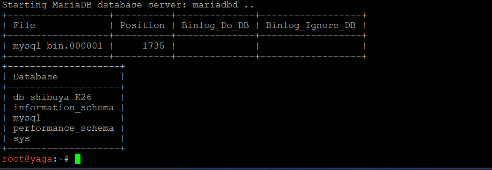 .
> 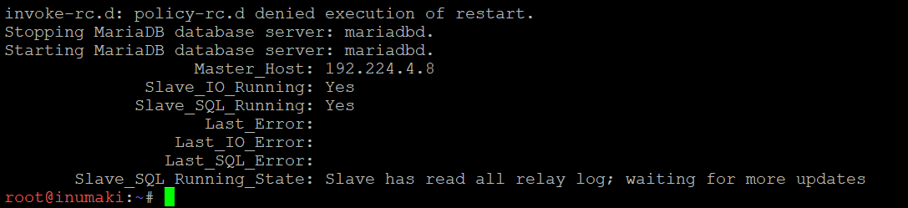 


14. Para penyihir lapangan bersiaga di Data Center sebagai pekerja backend untuk memproses aplikasi. Pasang Nginx dan PHP-FPM pada maki dan panda untuk menyajikan web frontend yang menampilkan hostname masing-masing. Pada nanami, todo, dan kirara, siapkan layanan API yang mencatat log request ke database yaga. Konfigurasikan virtual host agar worker merespons domain layanan yang ditentukan. Batasi akses langsung dari klien ke worker, web worker hanya menerima trafik melalui jalur proxy web yang ditentukan, sedangkan worker API hanya menerima trafik melalui geto. Uji bahwa akses langsung dari klien ditolak, sementara akses melalui reverse proxy tetap berhasil.

**Penjelasan soal**

Data Center berisi dua jenis worker:

- **Web frontend** (`maki`, `panda`): Nginx + PHP-FPM, halaman menampilkan hostname masing-masing.
- **API** (`nanami`, `todo`, `kirara`): Nginx + PHP-FPM, setiap request dicatat ke tabel `request_logs` di database yaga.

Ada dua aturan penting:

1. **Virtual host** memakai `server_name` domain layanan. Di sini dipakai `jujutsu.K26.com` dan `www.jujutsu.K26.com`, yaitu domain yang dikirim gojo. Kalau tabel spesifikasimu menyebut domain lain, ganti nilainya.
2. **Akses dibatasi.** Worker web hanya menerima trafik dari **gojo** (`192.224.1.4`). Worker API hanya menerima trafik dari **geto** (`192.224.4.2`). Akses langsung dari client harus ditolak (HTTP 403).

**Langkah 1. Worker web (maki dan panda)**

Script yang sama dijalankan di kedua node. Simpan sebagai `/root/soal14-web.sh`.

```bash
#!/bin/bash
echo "nameserver 192.168.122.1" > /etc/resolv.conf
apt-get update
DEBIAN_FRONTEND=noninteractive apt-get install -y nginx php-fpm curl
PHPV=$(ls /etc/php | head -1)

mkdir -p /var/www/web
cat > /var/www/web/index.php <<'EOF'
<?php
echo "<h1>Web Frontend</h1><p>Hostname: " . gethostname() . "</p>";
EOF

rm -f /etc/nginx/sites-enabled/default
cat > /etc/nginx/sites-available/web <<'EOF'
server {
    listen 80;
    server_name jujutsu.K26.com www.jujutsu.K26.com;
    root /var/www/web;
    index index.php;

    allow 192.224.1.4;
    deny all;

    location / { try_files $uri $uri/ =404; }
    location ~ \.php$ {
        include snippets/fastcgi-php.conf;
        fastcgi_pass unix:/run/php/php__PHPV__-fpm.sock;
    }
}
EOF
sed -i "s/__PHPV__/$PHPV/" /etc/nginx/sites-available/web
ln -sf /etc/nginx/sites-available/web /etc/nginx/sites-enabled/web

service php$PHPV-fpm restart
nginx -t && service nginx restart
```

**Penjelasan script web**

| Bagian | Fungsi |
| --- | --- |
| `apt-get install nginx php-fpm` | Nginx sebagai web server, PHP-FPM sebagai pemroses PHP. |
| `PHPV=$(ls /etc/php ...)` | Mendeteksi versi PHP otomatis, karena nama socket PHP-FPM mengikuti versi. |
| `index.php` | Menampilkan `gethostname()`, jadi maki menampilkan "maki" dan panda menampilkan "panda". |
| `rm sites-enabled/default` | Menghapus site bawaan Nginx supaya tidak bentrok `default_server`. |
| `server_name` | Virtual host hanya merespons domain layanan. |
| `allow 192.224.1.4; deny all;` | Hanya gojo yang boleh mengakses. IP lain mendapat 403. |
| `fastcgi_pass unix:...sock` | Meneruskan file `.php` ke PHP-FPM lewat socket. |
| `nginx -t` | Cek sintaks sebelum restart. |

**Langkah 2. Worker API (nanami, todo, kirara)**

Script yang sama dijalankan di ketiga node. Simpan sebagai `/root/soal14-api.sh`.

```bash
#!/bin/bash
echo "nameserver 192.168.122.1" > /etc/resolv.conf
apt-get update
DEBIAN_FRONTEND=noninteractive apt-get install -y nginx php-fpm php-mysql curl
PHPV=$(ls /etc/php | head -1)

mkdir -p /var/www/api
cat > /var/www/api/index.php <<'EOF'
<?php
header('Content-Type: application/json');
$host = gethostname();
$ip = $_SERVER['HTTP_X_REAL_IP'] ?? $_SERVER['REMOTE_ADDR'];
try {
    $pdo = new PDO("mysql:host=192.224.4.8;dbname=db_shibuya_K26", "shibuya", "ShibuyaPass123");
    $st = $pdo->prepare("INSERT INTO request_logs (hostname, client_ip, uri) VALUES (?,?,?)");
    $st->execute([$host, $ip, $_SERVER['REQUEST_URI']]);
    echo json_encode(["server" => $host, "status" => "logged"]);
} catch (Exception $e) {
    http_response_code(500);
    echo json_encode(["server" => $host, "error" => $e->getMessage()]);
}
EOF

rm -f /etc/nginx/sites-enabled/default
cat > /etc/nginx/sites-available/api <<'EOF'
server {
    listen 80;
    server_name jujutsu.K26.com www.jujutsu.K26.com;
    root /var/www/api;
    index index.php;

    allow 192.224.4.2;
    deny all;

    location / { try_files $uri $uri/ /index.php?$query_string; }
    location ~ \.php$ {
        include snippets/fastcgi-php.conf;
        fastcgi_pass unix:/run/php/php__PHPV__-fpm.sock;
    }
}
EOF
sed -i "s/__PHPV__/$PHPV/" /etc/nginx/sites-available/api
ln -sf /etc/nginx/sites-available/api /etc/nginx/sites-enabled/api

service php$PHPV-fpm restart
nginx -t && service nginx restart
```

**Penjelasan script API**

| Bagian | Fungsi |
| --- | --- |
| `php-mysql` | Ekstensi PHP agar bisa terhubung ke MariaDB. |
| `new PDO("mysql:host=192.224.4.8 ...")` | Koneksi ke database di yaga memakai user `shibuya` (dibuat di soal 13). |
| `INSERT INTO request_logs` | Mencatat hostname worker, IP klien, dan URI untuk setiap request. |
| `json_encode(["server" => $host ...])` | Respons JSON berisi nama worker yang menjawab. Ini yang dipakai untuk membuktikan load balancing. |
| `try/catch` dan kode 500 | Kalau database tidak bisa dihubungi, respons berisi pesan error (membantu debugging). |
| `allow 192.224.4.2; deny all;` | Hanya geto yang boleh mengakses worker API. |
| `try_files ... /index.php` | Semua path (termasuk `/api`) diarahkan ke `index.php`. |

Catatan: untuk saat ini IP klien diambil dari `X-Real-IP` kalau ada. Cara ini belum aman dan diperbaiki di soal 17.

**Pengujian**

Akses langsung dari client harus **ditolak**. Jalankan di `itadori` (Alpine: `apk add curl` dulu):
```
for ip in 192.224.4.3 192.224.4.4 192.224.4.5 192.224.4.6 192.224.4.7; do
  echo "== $ip"; curl -s -o /dev/null -w "%{http_code}\n" http://$ip/
done
```
Hasil yang benar: kelima IP menghasilkan `403`.

Akses dari jalur yang diizinkan harus **berhasil**:
```
# di gojo (jalur web)
curl -s http://192.224.4.3/
curl -s http://192.224.4.4/

# di geto (jalur API)
curl -s http://192.224.4.5/
curl -s http://192.224.4.6/
curl -s http://192.224.4.7/
```
Web menampilkan `Hostname: maki` / `panda`. API menjawab `{"server":"nanami","status":"logged"}` dan seterusnya.

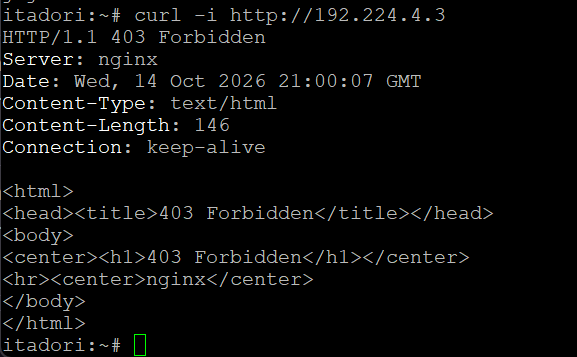
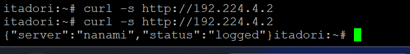

15. Geto bertugas mengendalikan pembagian beban request API di internal Data Center agar server tidak tumbang bersamaan. Konfigurasikan Nginx pada geto sebagai Load Balancer internal dengan upstream api_cluster yang mengarahkan trafik ke nanami dan todo. Terapkan algoritma Weighted Round Robin dengan bobot 3:1, di mana nanami menerima porsi beban tiga kali lebih banyak daripada todo. Buktikan distribusi beban ini dengan melakukan loop request berulang kali ke geto dari jaringan lokal Data Center dan periksa rasio responnya. 

**Penjelasan soal**

`geto` menjadi **load balancer internal** untuk API. Request API tidak langsung ke satu server, melainkan dibagi ke `nanami` dan `todo`. Algoritmanya **Weighted Round Robin** dengan bobot 3:1: dari setiap 4 request, 3 dijawab nanami dan 1 dijawab todo. Dengan begitu server yang lebih kuat menanggung beban lebih besar.

**Langkah. Konfigurasi geto**

Simpan sebagai `/root/soal15.sh`, lalu jalankan di geto.

```bash
#!/bin/bash
echo "nameserver 192.168.122.1" > /etc/resolv.conf
apt-get update
DEBIAN_FRONTEND=noninteractive apt-get install -y nginx curl
rm -f /etc/nginx/sites-enabled/default

cat > /etc/nginx/conf.d/api_lb.conf <<'EOF'
upstream api_cluster {
    server 192.224.4.5:80 weight=3;
    server 192.224.4.6:80 weight=1;
}

server {
    listen 80;
    location / {
        proxy_pass http://api_cluster;
        proxy_set_header Host $host;
        proxy_set_header X-Real-IP $remote_addr;
        proxy_set_header X-Forwarded-For $proxy_add_x_forwarded_for;
    }
}
EOF

nginx -t && service nginx restart
```

**Penjelasan script**

| Bagian | Fungsi |
| --- | --- |
| `upstream api_cluster` | Kelompok server backend bernama `api_cluster` (nama sesuai soal). |
| `server 192.224.4.5:80 weight=3` | nanami, bobot 3. |
| `server 192.224.4.6:80 weight=1` | todo, bobot 1. Total bobot 4, jadi rasio 3:1. |
| `proxy_pass http://api_cluster` | Meneruskan request ke upstream. Nginx otomatis memilih server berdasarkan bobot. |
| `proxy_set_header` | Meneruskan `Host` dan informasi IP klien ke worker. |
| `rm sites-enabled/default` | Supaya site bawaan tidak bentrok dengan server baru. |

**Pengujian**

Jalankan dari host lain di jaringan lokal Data Center, misalnya `tengen` (`apt-get install -y curl` dulu):
```
for i in $(seq 1 40); do curl -s http://192.224.4.2/; echo; done | grep -o '"server":"[a-z]*"' | sort | uniq -c
```
Hasil yang diharapkan:
```
     30 "server":"nanami"
     10 "server":"todo"
```
Rasio 30:10 sama dengan 3:1.

**Gambar yang dibutuhkan**
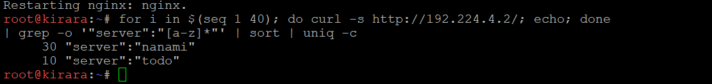

16.  Gojo berdiri di perbatasan DMZ sebagai gerbang publik tunggal bagi seluruh client dari luar maupun dalam.Konfigurasikan Nginx pada gojo untuk melayani domain jujutsu.<xxxx>.com 
dan www.jujutsu.<xxxx>.com menggunakan metode Path-Based Routing. 
Atur agar request root (/) diteruskan secara Round Robin ke worker frontend (maki dan panda), sedangkan request ke path /api diteruskan langsung ke geto. Uji dari client Divisi A atau B bahwa akses ke web utama dibalas oleh Maki/Panda, sedangkan akses ke /api diteruskan dan dijawab oleh Nanami/Todo.

**Penjelasan soal**

`gojo` adalah **gerbang publik tunggal**. Semua client mengakses `jujutsu.K26.com` (dan `www`) ke gojo, lalu gojo membagi request berdasarkan *path* (**Path-Based Routing**):

- `/` diteruskan ke worker web `maki` dan `panda` secara **Round Robin** (bergantian).
- `/api` diteruskan ke `geto`, yang kemudian membagi ke nanami dan todo.

**Langkah. Konfigurasi gojo**

Simpan sebagai `/root/soal16.sh`, lalu jalankan di gojo.

```bash
#!/bin/bash
echo "nameserver 192.168.122.1" > /etc/resolv.conf
apt-get update
DEBIAN_FRONTEND=noninteractive apt-get install -y nginx curl
rm -f /etc/nginx/sites-enabled/default

cat > /etc/nginx/conf.d/gateway.conf <<'EOF'
upstream web_cluster {
    server 192.224.4.3:80;
    server 192.224.4.4:80;
}

server {
    listen 80;
    server_name jujutsu.K26.com www.jujutsu.K26.com;

    location / {
        proxy_pass http://web_cluster;
        proxy_set_header Host $host;
    }
    location /api {
        proxy_pass http://192.224.4.2;
        proxy_set_header Host $host;
    }
}
EOF

nginx -t && service nginx restart
```

**Penjelasan script**

| Bagian | Fungsi |
| --- | --- |
| `upstream web_cluster` | Kelompok worker web: maki dan panda. Tanpa `weight`, Nginx memakai Round Robin. |
| `server_name` | Gojo hanya melayani `jujutsu.K26.com` dan `www.jujutsu.K26.com`. |
| `location /` | Semua request biasa diteruskan ke `web_cluster`. |
| `location /api` | Request berawalan `/api` diteruskan ke geto (`192.224.4.2`). Nginx memilih `location` dengan awalan paling spesifik, jadi `/api` tidak masuk ke `/`. |
| `proxy_set_header Host $host` | Menjaga nama domain asli sampai ke worker. |

**Pengujian**

Dari client Divisi A atau B (`itadori` atau `ino`; Alpine perlu `apk add curl`):

Web utama, dijawab maki dan panda bergantian:
```
for i in 1 2 3 4; do curl -s http://jujutsu.K26.com/ | grep -o "Hostname: [a-z]*"; done
```
Hasil: `maki`, `panda`, `maki`, `panda`.

Domain `www`:
```
curl -s http://www.jujutsu.K26.com/ | grep -o "Hostname: [a-z]*"
```

API, dijawab nanami dan todo:
```
for i in 1 2 3 4 5 6 7 8; do curl -s http://jujutsu.K26.com/api; echo; done
```
Hasil: `"server":"nanami"` muncul 6 kali dan `"server":"todo"` 2 kali.

Akses langsung worker dari client tetap ditolak:
```
curl -s -o /dev/null -w "%{http_code}\n" http://192.224.4.3/
```
Hasil: `403`.

Kalau DNS belum siap, pakai `curl -H "Host: jujutsu.K26.com" http://192.224.1.4/`.

**Gambar yang dibutuhkan**
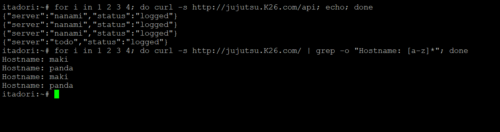
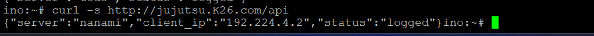


17. Komando pusat perlu mengetahui IP asli klien yang mengirimkan 
request tanpa tertukar dengan IP proxy perantara. Konfigurasikan gojo dan geto agar meneruskan informasi alamat klien melalui header X-Real-IP dan X-Forwarded-For. Pastikan geto hanya mempercayai informasi alamat klien yang diterima dari proxy terpercaya, dan skrip API menyimpan alamat klien yang telah diverifikasi ke kolom client_ip pada tabel request_logs di database yaga. Uji dengan mengirimkan request dari klien Network 2 dan Network 3 ke endpoint /api, kemudian periksa database untuk memastikan alamat yang tercatat sesuai dengan IP klien asal, bukan IP gojo atau geto.

**Penjelasan soal**

Karena request melewati dua proxy (gojo lalu geto), worker hanya melihat IP proxy sebagai pengirim. Soal meminta IP **asli client** tetap tercatat di kolom `client_ip`. Mekanismenya:

1. **gojo** mengirim header `X-Real-IP` (IP client) dan `X-Forwarded-For` (rantai IP perantara).
2. **geto** memakai modul `realip` yang **hanya mempercayai** header itu kalau datang dari gojo (proxy terpercaya). Dari sumber lain, header diabaikan sehingga tidak bisa dipalsukan.
3. **Skrip API** hanya memakai `X-Real-IP` kalau request datang dari geto, memvalidasi bahwa nilainya IP yang sah, lalu menyimpannya ke `client_ip`.

**Langkah 1. gojo**

```bash
cat > /etc/nginx/conf.d/gateway.conf <<'EOF'
upstream web_cluster {
    server 192.224.4.3:80;
    server 192.224.4.4:80;
}

server {
    listen 80;
    server_name jujutsu.K26.com www.jujutsu.K26.com;

    location / {
        proxy_pass http://web_cluster;
        proxy_set_header Host $host;
        proxy_set_header X-Real-IP $remote_addr;
        proxy_set_header X-Forwarded-For $proxy_add_x_forwarded_for;
    }
    location /api {
        proxy_pass http://192.224.4.2;
        proxy_set_header Host $host;
        proxy_set_header X-Real-IP $remote_addr;
        proxy_set_header X-Forwarded-For $proxy_add_x_forwarded_for;
    }
}
EOF
nginx -t && service nginx reload
```

**Langkah 2. geto**

```bash
cat > /etc/nginx/conf.d/api_lb.conf <<'EOF'
upstream api_cluster {
    server 192.224.4.5:80 weight=3;
    server 192.224.4.6:80 weight=1;
}

set_real_ip_from 192.224.1.4;
real_ip_header X-Real-IP;

server {
    listen 80;
    location / {
        proxy_pass http://api_cluster;
        proxy_set_header Host $host;
        proxy_set_header X-Real-IP $remote_addr;
        proxy_set_header X-Forwarded-For $proxy_add_x_forwarded_for;
    }
}
EOF
nginx -t && service nginx reload
```

**Langkah 3. Worker API (nanami, todo, kirara)**

Skrip ini menimpa `index.php` dari soal 14:
```bash
cat > /var/www/api/index.php <<'EOF'
<?php
header('Content-Type: application/json');
$host   = gethostname();
$remote = $_SERVER['REMOTE_ADDR'];
$ip     = $remote;
if ($remote === '192.224.4.2' && !empty($_SERVER['HTTP_X_REAL_IP'])
    && filter_var($_SERVER['HTTP_X_REAL_IP'], FILTER_VALIDATE_IP)) {
    $ip = $_SERVER['HTTP_X_REAL_IP'];
}
try {
    $pdo = new PDO("mysql:host=192.224.4.8;dbname=db_shibuya_K26", "shibuya", "ShibuyaPass123");
    $st = $pdo->prepare("INSERT INTO request_logs (hostname, client_ip, uri) VALUES (?,?,?)");
    $st->execute([$host, $ip, $_SERVER['REQUEST_URI']]);
    echo json_encode(["server" => $host, "client_ip" => $ip, "status" => "logged"]);
} catch (Exception $e) {
    http_response_code(500);
    echo json_encode(["server" => $host, "error" => $e->getMessage()]);
}
EOF
php -l /var/www/api/index.php
```

**Penjelasan script**

| Bagian | Fungsi |
| --- | --- |
| gojo: `X-Real-IP $remote_addr` | Gojo **menimpa** header ini dengan IP koneksi yang sebenarnya. Kalau client mengirim `X-Real-IP` palsu, nilainya dibuang. |
| gojo: `X-Forwarded-For $proxy_add_x_forwarded_for` | Menambahkan IP client ke rantai proxy. |
| geto: `set_real_ip_from 192.224.1.4` | Hanya gojo yang dipercaya untuk memberi informasi IP client. |
| geto: `real_ip_header X-Real-IP` | Header yang dibaca untuk mengganti `$remote_addr`. Setelah ini `$remote_addr` di geto berisi IP client asli. |
| geto: `proxy_set_header X-Real-IP $remote_addr` | Meneruskan IP client asli ke worker. |
| PHP: `$remote === '192.224.4.2'` | Worker hanya percaya header kalau pengirimnya geto. |
| PHP: `filter_var(..., FILTER_VALIDATE_IP)` | Memastikan nilainya benar-benar IP, bukan teks sembarang (mencegah injeksi). |
| PHP: `"client_ip" => $ip` | IP yang sudah diverifikasi disimpan ke database dan ditampilkan di respons. |

**Pengujian**

Dari `itadori` (Network 2) dan `ino` (Network 3):
```
curl -s http://jujutsu.K26.com/api
```
Respons memuat `"client_ip"` berisi IP client masing-masing (misal `192.224.2.x` dan `192.224.3.x`).

Periksa database di yaga:
```
mariadb -e "SELECT id,hostname,client_ip,uri FROM db_shibuya_K26.request_logs ORDER BY id DESC LIMIT 10;"
```
Kolom `client_ip` harus IP itadori dan ino, **bukan** `192.224.1.4` (gojo) atau `192.224.4.2` (geto).

Uji pemalsuan header lewat gojo, dari client:
```
curl -s -H "X-Real-IP: 1.2.3.4" http://jujutsu.K26.com/api
```
`client_ip` tetap IP asli client, bukan `1.2.3.4`.

Uji kepercayaan geto, dari `tengen` (bukan gojo) langsung ke geto:
```
curl -s -H "X-Real-IP: 9.9.9.9" http://192.224.4.2/
```
`client_ip` berisi `192.224.4.10` (IP tengen). Header `9.9.9.9` diabaikan karena tengen bukan proxy terpercaya.

**Gambar yang dibutuhkan**
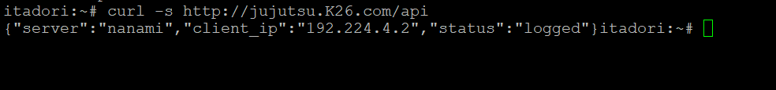
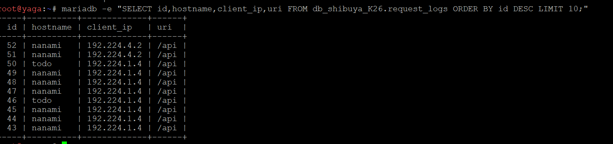


18.  nanami dan todo merupakan worker API utama, sedangkan kirara 
disiapkan sebagai worker cadangan. Konfigurasikan upstream 
api_cluster pada geto agar kirara menjadi server backup, serta 
terapkan passive health check dengan parameter max_fails=2 dan 
fail_timeout=5s pada worker API utama. Pastikan kirara menjalankan layanan API yang kompatibel dengan endpoint utama. Simulasikan gangguan dengan menghentikan layanan Nginx atau layanan API pada nanami dan todo. Buktikan dari klien bahwa request ke /api dialihkan ke kirara dan menghasilkan respons API yang valid tanpa error 502 Bad Gateway.

**Penjelasan soal**

`nanami` dan `todo` adalah worker API utama, `kirara` adalah **cadangan** yang baru dipakai kalau keduanya mati. Soal meminta:

1. `kirara` ditandai `backup` di upstream `api_cluster`.
2. **Passive health check**: kalau sebuah worker gagal 2 kali (`max_fails=2`), Nginx menganggapnya mati selama 5 detik (`fail_timeout=5s`) dan tidak mengirim request ke sana.
3. Kirara menjalankan API yang sama dengan endpoint utama (sudah, dari script soal 14 dan 17).
4. Saat nanami dan todo dimatikan, request `/api` tetap berhasil dijawab kirara, tanpa error 502.

**Langkah. Konfigurasi geto**

```bash
cat > /etc/nginx/conf.d/api_lb.conf <<'EOF'
upstream api_cluster {
    server 192.224.4.5:80 weight=3 max_fails=2 fail_timeout=5s;
    server 192.224.4.6:80 weight=1 max_fails=2 fail_timeout=5s;
    server 192.224.4.7:80 backup;
}

set_real_ip_from 192.224.1.4;
real_ip_header X-Real-IP;

server {
    listen 80;
    location / {
        proxy_pass http://api_cluster;
        proxy_connect_timeout 2s;
        proxy_next_upstream error timeout http_502 http_503 http_504;
        proxy_set_header Host $host;
        proxy_set_header X-Real-IP $remote_addr;
        proxy_set_header X-Forwarded-For $proxy_add_x_forwarded_for;
    }
}
EOF
nginx -t && service nginx reload
```

**Penjelasan script**

| Bagian | Fungsi |
| --- | --- |
| `max_fails=2` | Setelah 2 kegagalan berturut-turut, server ditandai tidak tersedia. |
| `fail_timeout=5s` | Lama server dianggap mati (5 detik), sekaligus jendela waktu penghitungan kegagalan. Setelah itu Nginx mencoba lagi. |
| `server 192.224.4.7:80 backup` | Kirara hanya menerima request kalau semua server utama tidak tersedia. |
| `proxy_next_upstream error timeout http_502 http_503 http_504` | Kalau sebuah worker error, request yang sama langsung dicoba ke server berikutnya. Inilah yang mencegah 502 sampai ke client. |
| `proxy_connect_timeout 2s` | Batas waktu koneksi pendek supaya perpindahan ke kirara cepat. |

Pastikan kirara sudah siap (dari geto):
```
curl -s http://192.224.4.7/
```

**Pengujian**

Kondisi normal, dari client:
```
for i in $(seq 1 8); do curl -s http://jujutsu.K26.com/api; echo; done
```
Hanya nanami dan todo yang menjawab. Kirara belum dipakai.

Simulasi gangguan: matikan layanan di **nanami dan todo**:
```
service nginx stop
```

Dari client, ulangi:
```
for i in $(seq 1 8); do curl -s -w " [%{http_code}]\n" http://jujutsu.K26.com/api; done
```
Semua respons `"server":"kirara"` dengan kode `200`, tanpa 502.

Variasi gangguan lain (Nginx hidup tapi API mati), di nanami dan todo:
```
service nginx start
PHPV=$(ls /etc/php | head -1); service php$PHPV-fpm stop
```
Nginx mengembalikan 502 ke geto, lalu geto mengalihkan ke kirara berkat `proxy_next_upstream`. Hasil di client tetap `kirara` dan `200`.

Pulihkan layanan di nanami dan todo:
```
service nginx start
PHPV=$(ls /etc/php | head -1); service php$PHPV-fpm start
```
Setelah sekitar 5 detik, nanami dan todo kembali dipakai.

**Gambar yang dibutuhkan**
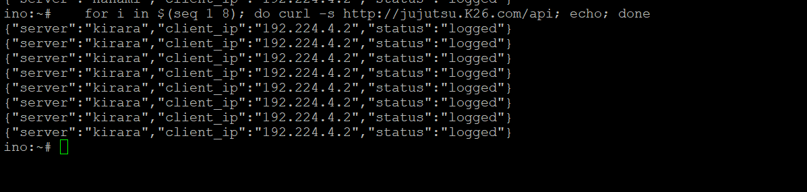
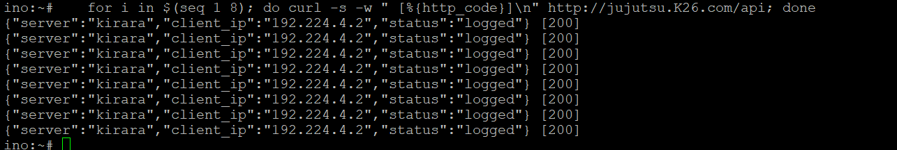

19. Gojo bertugas mengoptimalkan layanan web sekaligus membatasi request berlebihan. Konfigurasikan Nginx Proxy Caching untuk halaman web frontend dengan masa berlaku cache 10 menit dan tambahkan header X-Cache-Status. Terapkan rate limiting pada path /api dengan batas 10 request per detik per IP klien. Buktikan bahwa request ke halaman web yang memenuhi syarat cache menghasilkan status MISS pada akses awal dan HIT pada akses berikutnya. Uji rate limiting secara terpisah dengan mengirimkan request beruntun ke /api, kemudian catat status respons yang dihasilkan ketika batas terlampaui.

**Penjelasan soal**

Ada dua optimasi di gojo:

1. **Proxy cache** untuk halaman web (`/`). Respons dari maki atau panda disimpan di gojo selama 10 menit. Request berikutnya dijawab langsung dari cache tanpa membebani worker. Header `X-Cache-Status` menunjukkan hasilnya: `MISS` (belum ada di cache, diambil dari worker) atau `HIT` (dijawab dari cache).
2. **Rate limiting** untuk `/api`: maksimal 10 request per detik per IP client. Kelebihannya ditolak, sehingga satu client tidak bisa membanjiri API.

**Langkah. Konfigurasi gojo**

```bash
mkdir -p /var/cache/nginx/web
cat > /etc/nginx/conf.d/gateway.conf <<'EOF'
upstream web_cluster {
    server 192.224.4.3:80;
    server 192.224.4.4:80;
}

proxy_cache_path /var/cache/nginx/web levels=1:2 keys_zone=web_cache:10m max_size=100m inactive=10m;
limit_req_zone $binary_remote_addr zone=api_limit:10m rate=10r/s;

log_format audit '$remote_addr "$request" $status ups=$upstream_status cache=$upstream_cache_status rl=$limit_req_status rt=$request_time';

server {
    listen 80;
    server_name jujutsu.K26.com www.jujutsu.K26.com;
    access_log /var/log/nginx/gojo_audit.log audit;

    location / {
        proxy_pass http://web_cluster;
        proxy_set_header Host $host;
        proxy_set_header X-Real-IP $remote_addr;
        proxy_set_header X-Forwarded-For $proxy_add_x_forwarded_for;

        proxy_cache web_cache;
        proxy_cache_valid 200 10m;
        add_header X-Cache-Status $upstream_cache_status always;
    }

    location /api {
        limit_req zone=api_limit;
        proxy_pass http://192.224.4.2;
        proxy_set_header Host $host;
        proxy_set_header X-Real-IP $remote_addr;
        proxy_set_header X-Forwarded-For $proxy_add_x_forwarded_for;
    }
}
EOF
nginx -t && service nginx restart
```

**Penjelasan script**

| Bagian | Fungsi |
| --- | --- |
| `proxy_cache_path ... keys_zone=web_cache:10m` | Lokasi penyimpanan cache di disk dan zona memori `web_cache` untuk indeks cache. |
| `inactive=10m` | Cache yang tidak diakses 10 menit dihapus. |
| `proxy_cache web_cache` | Mengaktifkan cache pada `location /`. |
| `proxy_cache_valid 200 10m` | Respons berstatus 200 berlaku 10 menit, sesuai soal. |
| `add_header X-Cache-Status $upstream_cache_status always` | Menambahkan header `X-Cache-Status` (`MISS`, `HIT`, dan lainnya) pada respons. |
| `limit_req_zone $binary_remote_addr zone=api_limit:10m rate=10r/s` | Menghitung request **per IP client**, batas 10 request per detik. |
| `limit_req zone=api_limit` | Menerapkan batas hanya pada `location /api`. Request yang melebihi batas ditolak dengan status 503 (bawaan Nginx). |
| `log_format audit` | Format log khusus yang mencatat status, hasil cache (`cache=`), dan status rate limit (`rl=`). Dipakai di soal 20 untuk analisis. |

**Pengujian cache**

Dari client:
```
curl -s -D - -o /dev/null http://jujutsu.K26.com/ | grep -i x-cache
curl -s -D - -o /dev/null http://jujutsu.K26.com/ | grep -i x-cache
curl -s -D - -o /dev/null http://jujutsu.K26.com/ | grep -i x-cache
```
Hasil: akses pertama `X-Cache-Status: MISS`, akses kedua dan seterusnya `X-Cache-Status: HIT`.

Kalau akses pertama sudah `HIT` karena cache lama, kosongkan cache di gojo lalu ulangi:
```
rm -rf /var/cache/nginx/web/* && service nginx reload
```
Saat `HIT`, hostname yang tampil selalu sama (maki atau panda) karena jawaban berasal dari cache. Itu normal.

**Pengujian rate limiting**

Kirim 40 request bersamaan dari client dan hitung hasilnya:
```
for i in $(seq 1 40); do curl -s -o /dev/null -w "%{http_code}\n" http://jujutsu.K26.com/api & done | sort | uniq -c
```
Hasil: sebagian `200` dan sisanya `503`. Status `503` adalah respons ketika batas terlampaui.

Bukti dari log gojo:
```
grep -c "rl=REJECTED" /var/log/nginx/gojo_audit.log
```

**Gambar yang dibutuhkan**
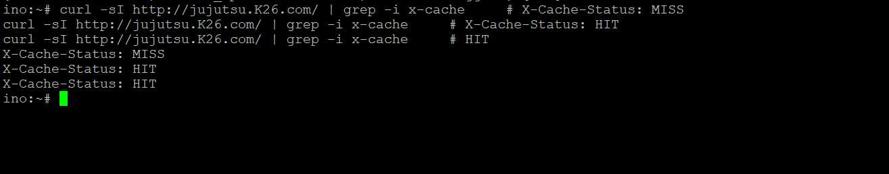
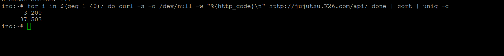


20. . Sebelum Curtain di Shibuya resmi dibuka, Kusakabe memimpin audit untuk menguji kapasitas layanan. Dari terminal kusakabe, jalankan benchmark menggunakan Apache Benchmark dengan parameter -n 600 -c 30 menuju http://jujutsu.<xxxx>.com/. Catat Requests per Second (RPS), latensi, dan jumlah request yang gagal. Lakukan 
pengujian tambahan pada endpoint /api untuk mengamati efek rate 
limiting. Bandingkan hasil pengujian baseline dengan hasil ketika rate limiting aktif, serta gunakan access log gojo untuk membedakan kegagalan aplikasi, koneksi, dan request yang ditolak oleh kebijakan rate limit.

**Penjelasan soal**

Ini audit kapasitas dari `kusakabe` memakai Apache Benchmark (`ab`). `-n 600` berarti total 600 request, `-c 30` berarti 30 request bersamaan. Yang dicatat: **Requests per Second (RPS)**, **latensi**, dan **jumlah request gagal**. Pengujian dilakukan tiga kali:

1. Halaman web `/` (dilayani cache gojo).
2. `/api` **tanpa** rate limiting (baseline).
3. `/api` **dengan** rate limiting aktif.

Lalu hasilnya dibandingkan, dan access log gojo dipakai untuk membedakan tiga jenis kegagalan: **aplikasi** (worker atau database error), **koneksi** (client atau jaringan putus), dan **ditolak rate limit** (kebijakan, bukan error).

**Langkah 1. Persiapan**

Di `kusakabe` (Alpine):
```
apk add apache2-utils
ping -c 2 jujutsu.K26.com
```

Di gojo, siapkan script untuk menyalakan dan mematikan rate limit. Simpan sebagai `/root/ratelimit.sh`:
```bash
#!/bin/bash
F=/etc/nginx/conf.d/gateway.conf
case "$1" in
  off) sed -i 's/^\(\s*\)limit_req zone/\1#limit_req zone/' $F ;;
  on)  sed -i 's/^\(\s*\)#limit_req zone/\1limit_req zone/' $F ;;
  *)   echo "pakai: bash ratelimit.sh on|off"; exit 1 ;;
esac
nginx -t && service nginx reload
grep -n limit_req $F
```

| Bagian | Fungsi |
| --- | --- |
| `off` | Memberi tanda `#` pada baris `limit_req zone`, sehingga rate limit nonaktif (baseline). |
| `on` | Menghapus tanda `#`, rate limit aktif lagi. |
| `nginx -t && service nginx reload` | Menguji sintaks lalu memuat ulang konfigurasi tanpa memutus koneksi. |
| `grep -n limit_req` | Menampilkan status baris `limit_req` sebagai bukti. |

**Langkah 2. Jalankan benchmark**

Sebelum setiap tahap, kosongkan log di gojo supaya analisisnya bersih:
```
: > /var/log/nginx/gojo_audit.log
```

Tahap 1, web `/` di kusakabe:
```
ab -n 600 -c 30 http://jujutsu.K26.com/ | tee /root/ab_web.txt
```

Tahap 2, `/api` tanpa rate limit. Di gojo `bash /root/ratelimit.sh off`, lalu di kusakabe:
```
ab -n 600 -c 30 http://jujutsu.K26.com/api | tee /root/ab_api_nolimit.txt
```

Tahap 3, `/api` dengan rate limit. Di gojo `bash /root/ratelimit.sh on`, lalu di kusakabe:
```
ab -n 600 -c 30 http://jujutsu.K26.com/api | tee /root/ab_api_limit.txt
```

Ringkasan angka dari ketiga hasil:
```
grep -E "Requests per second|Time per request|Failed requests|Non-2xx" /root/ab_*.txt
```

**Langkah 3. Catat hasil**

| Metrik (baris di output `ab`) | Web `/` | `/api` tanpa limit | `/api` dengan limit |
| --- | --- | --- | --- |
| Requests per second | 5010.86 [#/sec] (mean) | 479.75 [#/sec] (mean) | 897.57 [#/sec] (mean) |
| Time per request (mean) | 5.987 [ms] (mean) | 62.533 [ms] (mean) | 33.424 [ms] (mean) |
| Time per request (across all concurrent requests) | 0.200 [ms] (mean, across all concurrent requests) | 2.084 [ms] (mean, across all concurrent requests) | 1.114 [ms] (mean, across all concurrent requests) |
| Failed requests | 0 | 0 | 0 |
| Non-2xx responses | 0 | 0 | 0 |

**Cara membaca hasil**

- **Web `/`** biasanya paling cepat (RPS tinggi) karena hampir semua request dijawab dari cache gojo.
- **`/api` tanpa limit** lebih lambat karena tiap request melewati geto, PHP, lalu menulis ke database.
- **`/api` dengan limit** punya `Non-2xx responses` besar (status 503). RPS terlihat tinggi karena request yang ditolak dijawab sangat cepat. Itu bukan berarti performa lebih baik, karena request yang benar-benar berhasil hanya sekitar 10 per detik.
- `Failed requests` pada `/api` bisa berisi hitungan **Length** walaupun tidak ada error. Respons `nanami` dan `todo` berbeda panjang, sehingga `ab` menganggap ukurannya tidak konsisten. Karena itu gunakan `Non-2xx responses` dan log gojo sebagai acuan kegagalan sebenarnya.

**Langkah 4. Analisis access log gojo**

Di gojo, setelah tahap 3 selesai:
```bash
L=/var/log/nginx/gojo_audit.log
echo "--- jumlah per status ---";      awk '{print $5}' $L | sort | uniq -c
echo "--- ditolak rate limit ---";      grep -c "rl=REJECTED" $L
echo "--- kegagalan aplikasi ---";      grep -E ' (500|502|504) ups=(500|502|504)' $L | wc -l
echo "--- kegagalan koneksi ---";       grep -E ' 499 ups=| (502|504) ups=-' $L | wc -l
echo "--- cache ---";                   grep -o "cache=[A-Z-]*" $L | sort | uniq -c
```

| Pola di log | Artinya |
| --- | --- |
| status `503`, `ups=-`, `rl=REJECTED` | **Ditolak rate limit.** Ini kebijakan, bukan error server. |
| status `500`/`502`/`504` dengan `ups=` sama | **Kegagalan aplikasi.** Worker, PHP-FPM, atau database bermasalah. |
| status `499`, atau `502`/`504` dengan `ups=-` | **Kegagalan koneksi.** Client memutus koneksi, atau gojo gagal tersambung ke upstream. |
| status `200` dengan `cache=HIT` atau `MISS` | Berhasil. Menunjukkan efektivitas cache pada web. |

Kalau `ab` melaporkan `Failed requests` besar tetapi log gojo tidak mencatat kegagalan aplikasi atau penolakan, penyebabnya di sisi koneksi (jaringan atau batas proses), bukan kebijakan rate limit.

**Gambar yang dibutuhkan**
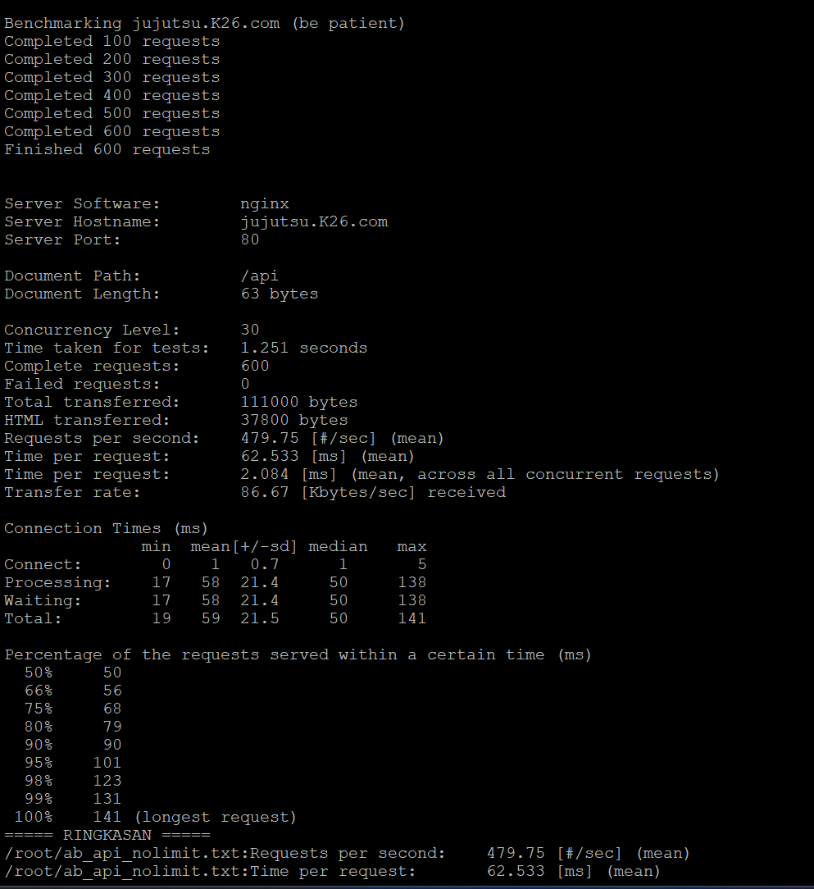
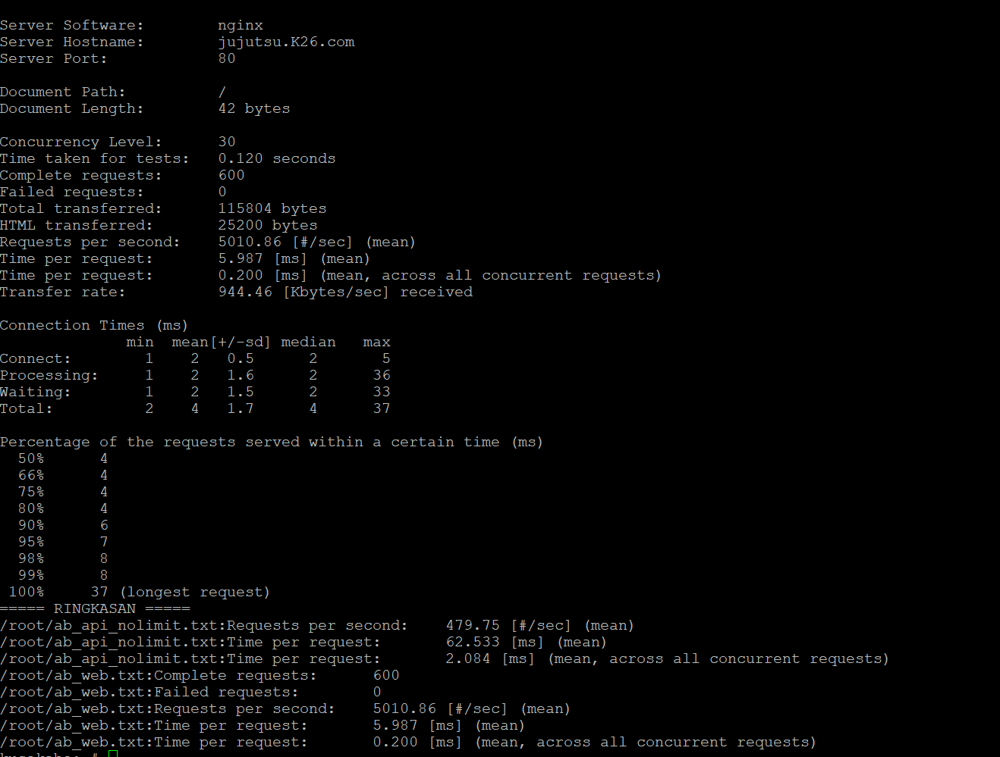
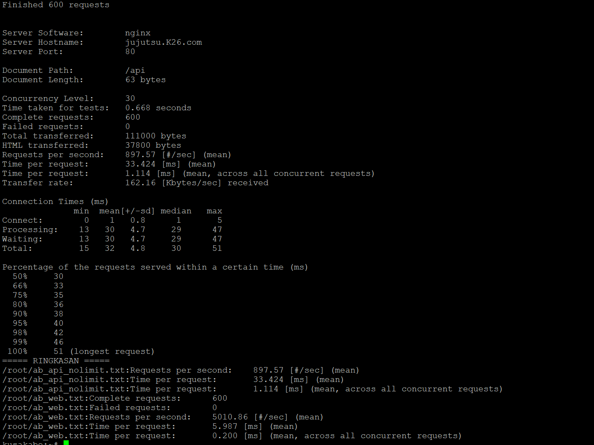
